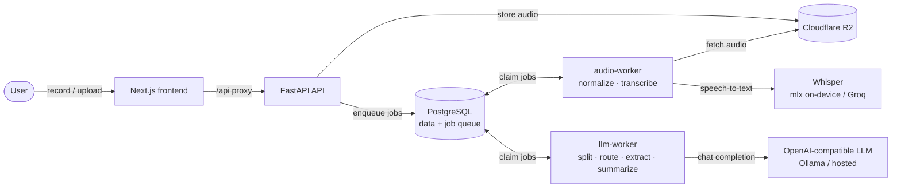

# Blurt-AI

> Blurt-AI turns voice notes into organized and reviewable records.

Record a voice memo, and Blurt-AI transcribes it, splits it into individual items,
routes each one to the right place (work log, task, note, or list), and extracts
structured fields — then hands them to you for review. Nothing is saved until you
approve it. Approved items are promoted into your work log, tasks, notes, and
lists, and rolled up into weekly summaries.

## Snapshots

_Coming soon._

## Architecture

**Pipeline:** `record → normalize → transcribe → split → route → extract → review → approve → work log / tasks / notes / lists → weekly summary`

The pipeline runs as a durable job queue in PostgreSQL (`SELECT … FOR UPDATE SKIP LOCKED`).
Two worker pools consume it — an **audio-worker** (`normalize`, `transcribe`) and an
**llm-worker** (`split`, `route`, `extract`, `summarize`) — so CPU-bound audio work and
LLM calls scale independently. A recording always ends in a terminal state (`ready` or
`failed`), never stuck mid-pipeline.

## Tech Stack

### Frontend
- **Next.js 16** (App Router) + **React 19**, **TypeScript**
- **Tailwind CSS v4** (Turbopack)
- **Passkeys** via `@simplewebauthn/browser` (WebAuthn), token in `localStorage`
- **Vitest** + Testing Library

### Backend
- **Python 3.12**, **FastAPI** + **Uvicorn**, a **uv** workspace monorepo (`core`, `backend/api`, `backend/worker`, `evals`)
- **SQLAlchemy 2** + **Alembic** migrations, **Pydantic v2** / pydantic-settings
- **Auth:** bcrypt password hashing + **JWT (HS256)**, WebAuthn passkeys (`py_webauthn`); all routes user-scoped
- **Job queue & workers:** custom PostgreSQL-backed queue with a split worker pool (audio / llm), graceful shutdown, stuck-job recovery, and terminal-failure handling

### Database
- **PostgreSQL** — application data *and* the durable job queue in one store
- Schema managed with **Alembic**; queue uses row-level locking (`FOR UPDATE SKIP LOCKED`)

### Infra
- **Docker** images for api, worker, and frontend
- **Kubernetes** (Kustomize base + overlays) — API/frontend Deployments, two worker Deployments, Postgres, a migrate Job
- **GitHub Actions** CI: ruff, mypy, pytest (backend) + eslint, tsc, vitest, build (frontend)
- **Cloudflare R2** (S3-compatible) for audio storage; **hivemind** for local multi-process dev

### Eval & AI
- **Speech-to-text:** OpenAI **Whisper** — `mlx-whisper` on-device (Apple Silicon) locally, **Groq** Whisper (`whisper-large-v3-turbo`) in the cloud; abstracted behind a provider interface
- **LLM:** OpenAI-compatible chat — **Ollama** (`llama3.1:8b`) locally, hosted (`gpt-oss-20b`) in the cluster — drives split, route, extract, and summarize, with tolerant JSON parsing
- **Eval harness (`blurt_evals`):** routing + extraction datasets, a runner and metrics, threshold gates, and a scheduled weekly eval in CI
