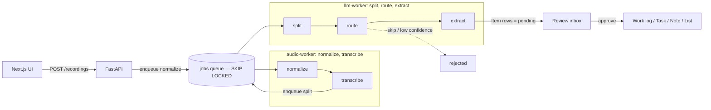

# ADR 0002: Pipeline stages and the PostgreSQL job queue

**Status:** Accepted

## Context

A voice memo has to pass through several processing steps — audio
normalization, transcription, splitting into spans, routing each span to a
section, and extracting structured fields — before a user reviews the result.
These steps have different cost profiles (CPU/audio vs. LLM calls) and need to
retry independently without blocking the API request that started them.

We already run PostgreSQL as the only data store (ADR 0001) and wanted to avoid
adding a separate broker (Redis/RabbitMQ/SQS).

## Decision

- Model the pipeline as a chain of **queued jobs** in a `jobs` table. Each
  stage handler does its work and enqueues the next stage, so the recording
  advances one durable step at a time.
- Stages: `normalize → transcribe → split → route → extract → (ready)`.
  Handlers live in `backend/worker/src/blurt_worker/handlers/`.
- Workers claim jobs with `SELECT … FOR UPDATE SKIP LOCKED`, so multiple
  workers pull from the same queue without double-processing.
- Partition workers by job kind via the `HANDLED_KINDS` env var
  (comma-separated; empty = handle all kinds). In the cluster this is two
  Deployments:
  - **audio-worker** — `normalize, transcribe`
  - **llm-worker** — `split, route, extract, summarize`
- Routing is gated: a span routed to `skip`, or below
  `ROUTER_CONFIDENCE_THRESHOLD`, is rejected rather than extracted. Extracted
  items land as `pending` for the user to review and approve.

